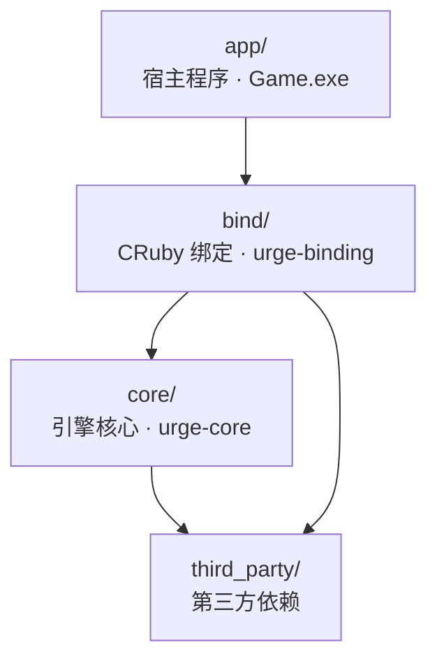
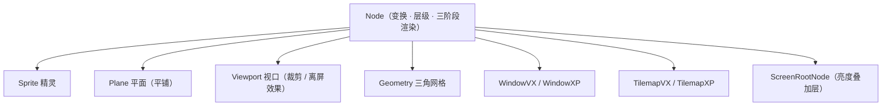
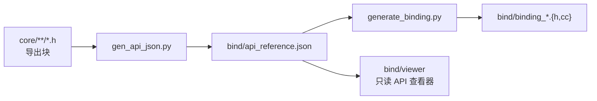

# URGE Core

**Universal Ruby Game Engine** · 基于 WebGPU 的 RGSS 运行时

[English](README_EN.md) | 简体中文

<br clear="left" />

---

## 1. 概览

**URGE（Universal Ruby Game Engine）** 是一个面向 Windows 平台的 RGSS（Ruby Game
Scripting System）运行时实现。引擎以现代 C++（C++20）从头编写，使用 WebGPU 作为硬件
加速的图形后端，并兼容 RPG Maker XP（RGSS1）、VX（RGSS2）与 VX Ace（RGSS3）三代脚本
API——既有工程原则上无需改动脚本即可运行。

引擎以 C++ 实现全部运行时设施（窗口、渲染、输入、音频、字体、文件系统），通过自动生成
的绑定层把这些原生对象暴露给内嵌的 CRuby 解释器；脚本侧看到的仍是 `Bitmap`、`Sprite`、
`Viewport`、`Graphics` 等熟悉的 RGSS 常量。

### 主要特性

| 特性 | 说明 |
| --- | --- |
| RGSS1 / 2 / 3 兼容 | 依据 `Game.ini` 的 `RGSS` 字段或脚本归档扩展名自动判定版本 |
| WebGPU 渲染后端 | 基于 wgpu-native，渲染目标统一为 `RGBA8Unorm`，present 阶段做 sRGB 补偿 |
| 3D 变换节点树 | 统一的 `Node` 基类，支持父子层级、位置/旋转/缩放与 Z 排序 |
| 自定义着色器效果 | `Effect` 可将任意 WGSL 片元着色器挂载到节点或其子树上 |
| 内嵌 CRuby | 直接执行 RPG Maker 的脚本归档（Marshal + zlib），无需外部 Ruby 环境 |
| 自动绑定生成 | 由 `core/**/*.h` 的导出块机械生成 CRuby 胶水，签名即契约 |
| 高像素密度适配 | 逻辑分辨率与物理像素解耦，高分屏下按系统缩放显示 |
| 虚拟文件系统 | 通过 PhysicsFS 统一装载脚本、资源与 RTP 路径 |

### 技术栈

| 组件 | 来源 | 用途 |
| --- | --- | --- |
| 语言 | C++20 | 引擎与宿主 |
| 窗口 / 输入 / 音频 | SDL3、SDL_image、SDL_ttf | 平台抽象、位图解码、字体栅格化 |
| 图形 API | WebGPU（wgpu-native） | 渲染后端 |
| 着色器工具链 | 无外部依赖 | WGSL 直接交给 wgpu，描述符布局由自研反射器从源码读出 |
| 脚本运行时 | CRuby 1.9.3（`third_party/cruby`） | 执行 RGSS 脚本 |
| 虚拟文件系统 | PhysicsFS（physfs） | 资源与 RTP 装载 |
| 数学库 | glm | 向量、矩阵与投影 |
| 压缩 | zlib | 脚本归档解压 |

### 目录结构

```
urge/
├── app/              宿主程序
│   ├── app.cc        入口：按序初始化各单例，随后进入脚本层
│   ├── platform/     平台相关实现（Win32 RTP 路径探测等）
│   └── resources/    应用图标与 Windows 版本资源
├── core/             引擎核心：与脚本无关的全部运行时设施
├── bind/             CRuby 绑定：自动生成的胶水 + 手写运行时层
│   └── viewer/       基于 IR 的只读 API 查看器
├── third_party/      第三方依赖（多数为 Git 子模块）
├── test/             测试
└── CMakeLists.txt
```

---

## 2. 构建

### 环境要求

| 项目 | 要求 |
| --- | --- |
| 操作系统 | **Windows 10 1809 及以上（x64）**。wgpu 在 Windows 上默认使用 DX12 后端，因此不支持 Windows 7 / 8 |
| 编译器 | Visual Studio 2022 或更新版本（MSVC，需支持 C++20） |
| 构建系统 | CMake ≥ 3.30 |
| Rust | stable 工具链（wgpu-native 通过 Corrosion 由 Cargo 构建） |
| 版本控制 | Git（依赖以子模块形式提供） |

### 获取与构建

```bash
git clone --recursive https://github.com/Admenri/urge.git
cd urge
cmake -S . -B build
cmake --build build --config Release --target Game
```

> `--recursive` 是必需的。全部第三方依赖以子模块或内嵌形式存在，缺失时 CMake 会在配置
> 阶段直接失败。

产物位于：

- Release：`build/app/Release/Game.exe`
- Debug：`build/app/Debug/Game.exe`

### 增量构建注意事项

`core/` 与 `bind/` 均以 `file(GLOB ...)` 收集源文件，CMake 会在**配置期**冻结该文件
列表。因此：

- **新增或删除源文件后**，需重新执行一次 `cmake -S . -B build`；否则新文件不会被编译，
  或在链接阶段报 `LNK2019` / `LNK2001`。
- 仅修改已有文件的内容时，直接 `cmake --build` 即可，无需重新配置。

### 运行

将 `Game.exe` 放入游戏工程目录（即包含 `Game.ini` 与 `Data/` 的目录）后直接运行。引擎以
可执行文件所在目录为工作目录，并按 `<可执行文件名>.ini` 读取配置。

`Game.ini` 示例：

```ini
[Game]
RGSS = 3
Scripts = Data/Scripts.rvdata2
Title = My Game
; RTP / RTP1 / RTP2 / RTP3 可选；Windows 下会自动探测已安装的运行库

[Window]
Width = 640
Height = 480

[Audio]
Soundfont = Fonts/Default.sf2

[GFX]
Backend =
```

配置项说明：

| 段 | 键 | 默认值 | 说明 |
| --- | --- | --- | --- |
| `Game` | `RGSS` | `0`（自动） | `1` = XP、`2` = VX、`3` = VX Ace；为 `0` 时按 `Scripts` 扩展名推断 |
| `Game` | `Scripts` | `Data/Scripts.rxdata` | 脚本归档路径 |
| `Game` | `Title` | `(*^▽^*)` | 窗口标题 |
| `Game` | `RTP` / `RTP1`–`RTP3` | 空 | RPG Maker 运行库名称 |
| `Window` | `Width` / `Height` | XP：`640x480`，其余：`544x416` | 逻辑分辨率 |
| `Audio` | `Soundfont` | `Fonts/Default.sf2` | MIDI 音色库 |
| `GFX` | `Backend` | 空（自动） | wgpu 后端选择 |

### 字体

Ruby 的 `Font` 与调试浮层（F1 / F2）共用同一个字体服务 `core/font_context.*`，两者永远画同一
个字形来源。字体名按以下顺序解析，先命中者胜：

1. `Fonts/` —— 游戏自带的字库（经加载路径读取，因此也能来自 `.acs` 归档）；
2. 系统字库 —— Windows 上为 `%WINDIR%\Fonts` 与 `%LOCALAPPDATA%\Microsoft\Windows\Fonts`；
3. 编译进可执行文件的内嵌字体（`core/resources/embed.ttf.bin`），始终可作为兜底。

字体既可写文件名（`msyh.ttc`、`simhei.ttf`，可省略扩展名），也可写族名（`Microsoft YaHei`、
`微软雅黑`、`SimHei`）——族名索引在首次按文件名查不到时才建立，只读各字体的 `name` 表。
Windows 上默认字体为**微软雅黑**（`msyh.ttc`），缺失时依次退到 `msyh.ttf`、`Deng.ttf`、
`simhei.ttf`、`simsun.ttc`，最后用内嵌字体；其他平台默认仍是内嵌字体。`Fonts/` 中的同名文件
优先于系统字库。字体字节按需读入并常驻，Ruby 侧与浮层共享同一份。

### 输入与手柄

`core/input/` 同时管理键盘与手柄，两者映射到同一套 slot（`A` / `B` / `C` / `X` / `Y` / `Z` /
`L` / `R` 与 `DOWN` / `LEFT` / `RIGHT` / `UP`）。手柄接上即用，支持热插拔；同一时刻只接管一个。

| 手柄按键 | slot |
| --- | --- |
| A（南）/ B（东）/ X（西）/ Y（北） | `C` / `B` / `A` / `X` |
| LB / RB | `L` / `R` |
| 十字键、左摇杆 | `LEFT` / `RIGHT` / `UP` / `DOWN` |

左摇杆与十字键并列驱动方向 slot（死区 50%），所以两种操作方式都原生可用。绑定保存在
`Game.ini` 的 `[KeyBinding]`，手柄项写成 `pad:<token>`（例如 `C=Space,Return,pad:a`）；
`[Input] PadBindings=true` 表示该文件由认识手柄的版本写过，没有它时会在加载时补上默认手柄绑定
（老存档的升级路径）。F1 面板里点 `Add` 后按下手柄按键，即可把它绑到该 slot。

> 蓝牙 Xbox 手柄需要 `third_party/SDL` 的一行本地补丁（上游把"假 HID 端点"的判定写宽了，
> 连蓝牙手柄的真实端点也一起拒掉），原因与验证见 `third_party/PATCHES.md`。

高级功能走 `Gamepad` 类：一个对象对应一只手柄，自己持有 SDL 句柄，可以同时持有多个。

```ruby
Gamepad.available_devices       # => [{ "id" => 2, "name" => "Xbox Series X Controller",
                                #       "path" => "...", "player" => 0, "guid" => "..." }, ...]
pad = Gamepad.new(2)            # 用 available_devices 里的 id 打开
pad.update                      # 每帧调一次；button_trigger? / button_repeat? 靠它推进

pad.button_press?(Gamepad::BUTTON_SOUTH)
pad.button_trigger?(Gamepad::BUTTON_SOUTH)
pad.button_repeat?(Gamepad::BUTTON_SOUTH)
pad.get_axis_value(Gamepad::AXIS_LEFTX)     # SDL 原始值：摇杆 -32768..32767，扳机 0..32767
pad.pressed_buttons             # => [按钮编号, ...]
pad.connect_state               # SDL 连接状态（0=未连、1=有线、2=无线）
pad.connect                     # 拔插后按 GUID 重新连上，成功返回 true
pad.player_index                # 可读可写
pad.rumble(0.5, 0.5, 200)       # 本引擎扩展：低频、高频、毫秒
```

常量 `Gamepad::AXIS_*`（`LEFTX` / `LEFTY` / `RIGHTX` / `RIGHTY` / `LEFT_TRIGGER` /
`RIGHT_TRIGGER`）与 `Gamepad::BUTTON_*`（`SOUTH` / `EAST` / `WEST` / `NORTH` / `BACK` /
`GUIDE` / `START` / `LEFT_STICK` / `RIGHT_STICK` / `LEFT_SHOULDER` / `RIGHT_SHOULDER` /
`DPAD_*` / `MISC1..6` / `RIGHT_PADDLE1/2` / `LEFT_PADDLE1/2` / `TOUCHPAD`）就是 SDL 的编号。
`Gamepad.new` 在设备已拔出时抛 `RGSSError`。

### 第三方依赖

以下依赖以 Git 子模块形式提供，需在克隆时一并拉取：

| 子模块 | 用途 |
| --- | --- |
| `glm` | 数学库 |
| `SDL` | 窗口、输入、音频与平台抽象 |
| `SDL_image` | 位图解码 |
| `SDL_ttf` | TrueType 字体栅格化（内含 FreeType / HarfBuzz / PlutoSVG） |
| `physfs` | 虚拟文件系统 |
| `wgpu-native` | WebGPU 实现（Rust） |
| `zlib` | 脚本归档解压 |

此外，`third_party/` 下还有几个**内嵌**依赖（非子模块）：`cruby`（CRuby 1.9.3）、
`libffi`（外部函数调用接口，为 `Win32API` 绑定提供 x64 下的 ABI 调用）、`webgpu-cpp`
（WebGPU C++ 头文件包装）、`miniaudio`、`imgui`、`dav1d` 与 `webm`。

解码类库跟着它们的消费者走：`libwebp` 位于 `third_party/SDL_image/external/`，
`ogg` / `vorbis` / `opus` / `opusfile` 位于 `third_party/miniaudio/external/`。

`libffi` 仅在 Windows 上参与构建（见 `third_party/CMakeLists.txt`）：它的唯一消费者是
`bind/binding_win32api.cc`，而该绑定在非 Windows 平台编译为空实现。它的构建脚本是上游
autotools 工程（`configure.ac` / `configure.host` / `Makefile.am`）的 CMake 逐行翻译，
而非重新设计。

---

## 3. 架构

### 分层

整个工程分为四层，依赖方向自上而下、单向：



- **`app/`** —— 宿主程序。`app.cc` 是唯一入口：解析可执行路径与 `Game.ini`，按依赖顺序
  初始化 `IOService`、`Config`、`Input`、`Mouse`、`FontContext`、`Graphics` 等单例，
  随后进入 `binding::BindingMain`；退出时按逆序释放。
- **`bind/`** —— CRuby 绑定静态库。它依赖 `urge-core` 但不含入口点；宿主负责
  `ruby_init()` 之后调用 `binding::InitBindings()`。
- **`core/`** —— 引擎核心，编译为静态库 `urge-core`，完全不含任何 Ruby 依赖。
- **`third_party/`** —— 以子模块或内嵌形式提供的全部外部依赖。

### 渲染管线

图形后端为 WebGPU（wgpu-native）。引擎仅使用一种渲染目标格式 `RGBA8Unorm`；交换链若为
`*Srgb` 格式，present 阶段用一个片元着色器做**精确的分段 sRGB 反编码**，使 sRGB 目标的
再编码相互抵消，从而在任意交换链格式下还原作者意图的颜色。

着色器以 **WGSL** 编写，源码原样交给 wgpu（两端后端都自带 WGSL 前端），没有任何运行期
翻译步骤；管线需要的描述符布局由 `core/wgsl_reflect.cc` 直接读源码得出。绑定的集合（set）
约定为：

| Set | 内容 |
| --- | --- |
| 0 | 场景级 uniform（屏幕尺寸、投影等） |
| 1 | 逐绘制对象 uniform（动态偏移，来自共享池） |
| 2 | 纹理与采样器 |
| 3 | 逐节点的参数（如精灵的颜色/色调/不透明度） |

为降低每帧的 CPU 开销，引擎采用两项批次化设计：

- **uniform 池**（`core/render/uniform.h`）：把一帧中同类逐绘制数据集中写入少数大缓冲区，以
  `dynamic offset` 寻址，取代"每个绘制对象一个缓冲区"。
- **帧顶点批**（`core/primitive.{h,cc}`）：整个帧共享一个顶点缓冲区，每个绘制对象以
  `firstVertex` 定位自己的顶点区间，把每帧数百次 `WriteBuffer` 压缩为一次。

一帧的推进顺序为：

```
SDL_AppIterate
  └─ Graphics::Update
       ├─（提交准备阶段：分配 uniform 槽位、追加顶点、Flush 上传）
       ├─ Node::Render（对屏幕纹理执行渲染通道）
       ├─ FPS 控制（FrameSkip / Delay）
       └─ PresentInternal（把屏幕纹理绘制到交换链）
```

### 节点树

所有可视对象统一继承自 `Node`，以侵入式双向链表（`DrawableSet`）维护父子关系，并支持
位置、四元数旋转与缩放的 3D 变换。`Node::Render` 以固定顺序驱动**三个阶段**：

| 阶段 | 职责 | 门控关系 |
| --- | --- | --- |
| `Prepare` | 追加几何到帧顶点批、写入 uniform | 返回 `true` 才会执行 `DoDraw` |
| `DoDraw` | 绑定管线/资源并发起绘制 | 返回 `true` 才会执行 `PostDraw` |
| `PostDraw` | 绘制后的收尾（如后处理、裁剪栈弹出） | — |

> 注意：**几何必须在 `Prepare` 阶段全部生成**——帧顶点批在两阶段之间上传，在 `DoDraw`
> 里追加的顶点不会被提交。

节点类型与 RGSS 概念的对应关系：



其中 `Tilemap` 与 `Window` 会按 `Game.ini` 中判定的 RGSS 版本分别绑定到 `TilemapVX` /
`TilemapXP` 与 `WindowVX` / `WindowXP`，从而在脚本侧呈现与目标版本一致的常量。

### 绑定生成

`core/` 中带 `/*-export.begin-*/` … `/*-export.end-*/` 标记的类会被导出到 Ruby。整条链路
只读取 `core/**/*.h`，不修改任何引擎源码，也不依赖 CRuby VM 的私有结构：



该流程在 **CMake 配置期自动触发**（`bind/gen_binding.cmake`），并且两个生成器都遵循
**"先比较、后写入"** 的原则：内容未变时不触碰磁盘，从而不改变生成物的 mtime，也就不会
触发多余的重新编译。新增一个导出类只需在 `gen_api_json.py` 的 `CLASS_ORDER` 中登记一次，
随后执行 `cmake -S . -B build` 即可。

### 当前 Ruby API 一览

| 类别 | 数量 | 名称 |
| --- | --- | --- |
| 类 | 23 | `Disposable`、`Node`、`Gamepad`、`Geometry`、`Bitmap`、`Color`、`Font`、`Image`、`Animation`、`Plane`、`Rect`、`Sprite`、`Table`、`Tone`、`Vector2`、`Vector3`、`Vector4`、`TilemapVX`、`TilemapXP`、`Viewport`、`WindowVX`、`WindowXP`、`Effect` |
| 模块 | 4 | `Graphics`、`Input`、`Audio`、`Mouse` |

### 核心模块地图

`core/` 按功能分组，include 路径就是目录路径（`core/<组>/<文件>`）：

| 目录 | 内容 |
| --- | --- |
| `common/` | 基础设施与数据类：`definition.h`（`URGE_BINDING` / `ATTR` / `MARSHAL_*` / `KLASS_EQUAL` 宏）、`object.h`、`refptr.h`、`disposable.h`、`utility.{h,cc}`（`Rect` / `Color` / `Tone` / `Vector2/3/4`）、`table.{h,cc}`（`Table` 数据表）、`exception.h`、`logger.h`、`inirw.h` |
| `system/` | 宿主设施：`config.{h,cc}`（`Game.ini`）、`filesystem.{h,cc}`（PhysicsFS 与 RTP 路径）、`archive.{h,cc}`（`.acs` 容器） |
| `graphics/` | **导出到 Ruby 的图形类**：`graphics.{h,cc}`（`Graphics` 模块：主循环、窗口与交换链、present、转场、快照、帧率控制）、`gpu.{h,cc}`（`GPU` 模块与全部 `GPU*` 描述符/对象）、`effect.{h,cc}`（`Effect` 自定义着色器） |
| `render/` | **内部渲染实现（不导出）**：`device.{h,cc}`（wgpu 设备与队列）、`pipeline.{h,cc}`、`shader.{h,cc}`、`gpu_utils.h`（绑定组/布局辅助）、`primitive.{h,cc}`（帧顶点批）、`uniform.{h,cc}`（逐帧 uniform 池）、`render_stats.h`、`imgui_manager.{h,cc}`（F1/F2 调试浮层） |
| `scene/` | **场景 node**：`node`（三阶段渲染派发）、`drawable`（可绘制链表）、`sprite` / `sprite_batch`、`plane`、`viewport`、`window_vx` / `window_xp`、`tilemap_vx` / `tilemap_xp`、`geometry`、`camera` |
| `canvas/` | **画布与附属**：`bitmap.{h,cc}`（位图、GPU 纹理、`Blt`/渐变/文字绘制）、`bitmap_queue.{h,cc}`（绘制命令队列）、`image.{h,cc}`（调色板）、`animation.{h,cc}`（帧序列） |
| `font/` | `font{,_context,_renderer}.{h,cc}`：字体解析（`Fonts/` → 系统字库 → 内嵌）、SDL_ttf 渲染与文本度量 |
| `audio/` | `audio.{h,cc}`（BGM / BGS / SE）、`audio_service.{h,cc}`、`audio_stream.{h,cc}` |
| `input/` | `input.{h,cc}`（键盘/手柄统一到 slot）、`gamepad.{h,cc}`（SDL3 手柄、热插拔、扳机/摇杆/震动、多手柄，脚本侧 `Gamepad` 类）、`mouse.{h,cc}`、`key_sym.h`（绑定项与按下/触发/重复状态机） |
| `network/` | `network.{h,cc}`（前端）、`network_backend.h`、`network_curl.cc` / `network_web.cc`（按平台二选一） |
| `video/` | `video{,_decoder,_demuxer,_player}.{h,cc}`：WebM/AV1 播放 |

---

<div align="center">
  <sub>Licensed under the <a href="LICENSE.txt">MIT License</a> · Copyright (c) 2026 Admenri Adev</sub>
</div>
